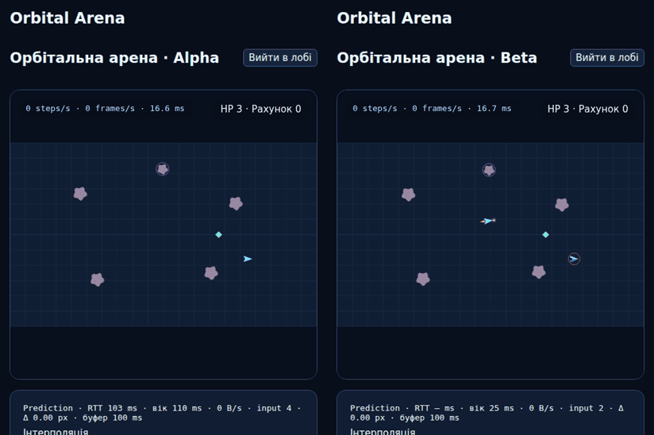
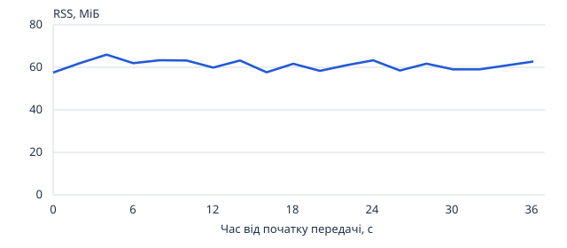
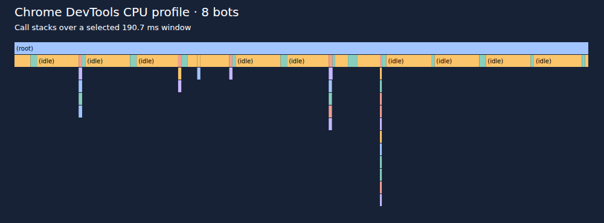
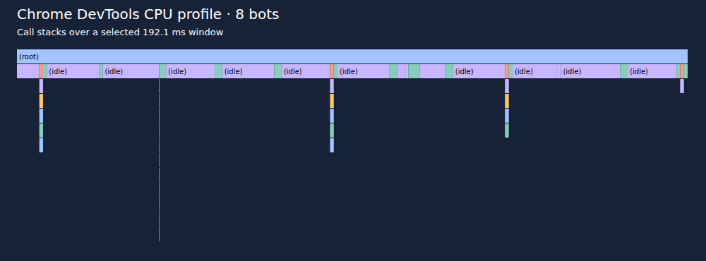
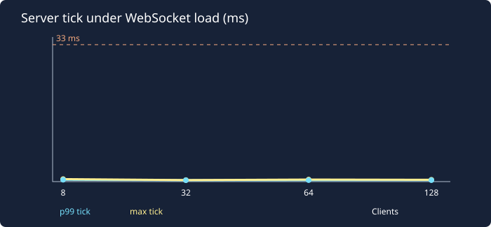
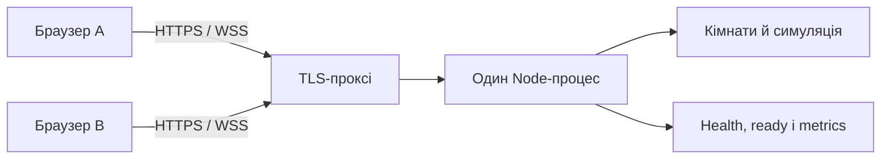

# Orbital Arena

**[Грати онлайн](https://orbital-arena-zuffull.onrender.com)** · [Стан сервера](https://orbital-arena-zuffull.onrender.com/health) · [Відео 3:15](docs/lab-08-demo.mp4)



Навчальна браузерна гра про космічні кораблі. Етапи розробки позначені тегами лабораторних. У першій версії можна керувати одним кораблем у циклі Canvas 2D.

## Запуск

Потрібен Node.js 22.12+ (рекомендовано 24).

```sh
npm install
npm run build
npm start
```

Відкрий `http://127.0.0.1:3000`. Для розробки є окремі команди в розділі лабораторної 04.

W або ↑ — тяга, A/D або ←/→ — поворот, Space — постріл, H — самонаведення. Краї арени з’єднані. HUD показує частоту фізики, частоту рендеру та інтервал між кадрами. `npm run build` збирає клієнт, `npm run lint` перевіряє код, а `npm run format` застосовує форматування Biome.

## Лабораторна 01. Ігровий цикл

Крок фізики — 1/60 с. Між викликами rAF додаю до акумулятора максимум 250 мс, щоб після зависання не накопичувалася черга з сотень кроків. Рендер отримує частку залишку й інтерполює між попереднім і поточним станом. Для координат і кута обираю найкоротший перехід через межу. Ігрові координати сталі, а роздільна здатність canvas залежить від розмірів на сторінці й DPR.

Тяга 360 одиниць/с², максимальна швидкість 430 одиниць/с, поворот 3,8 рад/с і коефіцієнт опору 0,65 с⁻¹. Інерція дозволяє повернути корабель без миттєвої зміни напряму польоту.

### Експерименти

У браузері відкрий гру з параметрами `?experiment=baseline&auto`, `?experiment=block&auto`, `?experiment=interval&auto` або `?experiment=variable&auto`. Наприкінці 10 с результат друкується в консолі. Jitter — стандартне відхилення інтервалу між callback’ами. Автопілот тримає тягу й однаковий поворот протягом 5 с симуляції.

### Заміри у Chrome на Windows

Десятисекундні прогони у Chrome headless. Для двох останніх рядків на 5 с перемикав активну вкладку. Chrome у цьому режимі показував `visibilityState=visible`, хоча частота викликів rAF знизилася.

| Режим | Callback/с | Середній кадр, мс | Jitter, мс | Максимум, мс |
| --- | ---: | ---: | ---: | ---: |
| rAF | 60,00 | 16,67 | 0,06 | 16,80 |
| rAF + busy-wait 100 мс кожні 60 кадрів | 55,51 | 18,01 | 10,51 | 100,10 |
| setInterval(frame, 16) | 62,51 | 16,00 | 0,69 | 17,70 |
| rAF, переключення вкладки | 30,70 | 32,57 | 123,95 | 1 016,70 |
| setInterval(frame, 16), переключення вкладки | 62,50 | 16,00 | 0,72 | 18,70 |

**Синхронне блокування.** Busy-wait займає головний потік приблизно на 100 мс. Поки стек не звільниться, введення й наступний callback рендеру чекають. Це видно за піком кадру та нижчою частотою рендеру.

**setInterval.** Таймер додає задачі, які не прив’язані до моменту виводу кадру. У замірі виклики йшли приблизно кожні 16 мс, а rAF — у такт з 60 Гц. Залежно від браузера й видимості вкладки таймер теж може сповільнюватися.

**Змінний крок із CPU throttling.** П’ять секунд однакового керування у Chrome.

| Режим | CPU | Кроків | X | Y |
| --- | ---: | ---: | ---: | ---: |
| Фіксований | 1× | 300 | 380,944695 | 565,479045 |
| Фіксований | 6× | 300 | 380,944695 | 565,479045 |
| Змінний | 1× | 301 | 380,944504 | 565,478618 |
| Змінний | 6× | 299 | 380,902159 | 566,066068 |

**Контрольований прогін кроку фізики.** Нижче фактичний прогін тієї самої функції фізики з контрольованими timestamp у Node.js. Частоти 60, 144 і 24 Гц відтворено синтетично. Цей прогін ізолює вплив частоти callback’ів.

| Крок | Callback/с | Кроків за 5 с | X | Y |
| --- | ---: | ---: | ---: | ---: |
| Фіксований | 60 | 300 | 380,945 | 565,479 |
| Фіксований | 144 | 300 | 380,945 | 565,479 |
| Фіксований | 24 | 300 | 380,945 | 565,479 |
| Змінний | 60 | 300 | 380,945 | 565,479 |
| Змінний | 144 | 720 | 381,445 | 567,834 |
| Змінний | 24 | 120 | 379,744 | 559,514 |

Чисельне інтегрування повороту, тяги й тертя залежить від того, на які відрізки поділено час. При фіксованому кроці поділ часу однаковий.

### Reflection

- Стек виконує поточну функцію до кінця. Об’єкти зберігаються у heap. Таймер планує задачу, а `Promise.then` планує microtask, яка виконається після поточного стеку до наступної задачі.
- rAF виконується під час підготовки зображення до показу. Таймер має приблизний інтервал і не синхронізується з оновленням зображення. Нескінченна черга microtask може не дати браузеру перейти до малювання.
- `alpha` — залишок часу в акумуляторі, поділений на розмір кроку. Обмеження delta захищає від довгого наздоганяння після паузи.
- Замикання зберігає доступ до змінних своєї області видимості. У `createInput()` множини приватні, а `justPressed()` один раз споживає подію. `let` у циклі створює окрему прив’язку для кожної ітерації.
- ES-модулі мають власну область видимості, працюють у strict mode, підтримують import/export, завантажуються з відкладеним виконанням і виконують код модуля один раз за URL.

## Лабораторна 02. Модель сутностей

**Демо.** Запусти гру командою `npm run dev`. Зі старту корабель дивиться прямо на помаранчевий дрон. Затисни **Space**, щоб збити його й отримати очко. Після вибуху дрон повернеться через 2 с. Натисни **R** і лети вперед клавішею **W**, щоб підібрати зелений щит. Він поглинає один удар. Клавіша **H** випускає фіолетову кулю із самонаведенням. Фіолетовий астероїд теж змінює напрямок у бік корабля.

### Помилка з `this`

Виклик `ship.fire()` отримує `ship` як `this`. Якщо передати метод напряму, як у `window.addEventListener("keydown", ship.fire)`, браузер викличе його з `this === window`, де немає полів корабля. Якщо викликати відокремлений метод як `const fire = ship.fire; fire()`, у strict mode `this` буде `undefined`. В обох випадках постріл зламається.

У грі слухачі лише запам’ятовують натискання, а `World.step` викликає `entity.fire()` у кроці симуляції. Якщо потрібен саме callback, підійде `() => ship.fire()` або `ship.fire.bind(ship)`. Для зняття слухача збережи посилання на створений callback.

### Чому композиція

`Entity` зберігає ідентифікатор і дані для руху. `Ship`, `Bullet`, `Asteroid`, `Explosion` і `Pickup` успадковуються від нього напряму. Спільний метод на кшталт `Vector2.add` повертає новий вектор, тому попередній стан можна безпечно використати для інтерполяції. `World` зберігає сутності у приватному `Map`. Спочатку оновлює їх, потім перевіряє пари кіл і в кінці видаляє позначені сутності.

З глибоким наслідуванням знадобилися б окремі `HomingBullet` і `HomingAsteroid`. Додавання ще однієї незалежної поведінки збільшило б кількість комбінацій. Тут `homing(kind, acceleration)` повертає функцію, яку куля й астероїд отримують у властивості `behavior`. `World` викликає її перед звичайним оновленням. `Pickup` має радіус для колізії і функцію `apply(ship)`, яка в цій версії активує щит. Інший бонус може передати іншу функцію, зберігши ті самі правила підбирання.

### Reflection

У консолі запущеної гри можна перевірити, де зберігається метод і як пов’язані прототипи:

```js
const { Ship, Entity } = await import("/src/sim/entity.js");
const ship = new Ship({ x: 0, y: 0 });
console.log(Object.hasOwn(ship, "fire")); // false
console.log(Object.getPrototypeOf(ship) === Ship.prototype); // true
console.log(Object.getPrototypeOf(Ship.prototype) === Entity.prototype); // true
```

- **Як визначається `this`?** У виклику методу його задає об’єкт ліворуч від крапки. `call`, `apply` і `bind` задають `this` явно. `new` створює екземпляр і підставляє його як `this`. У звичайному виклику в strict mode `this` дорівнює `undefined`. Стрілкова функція бере `this` із зовнішньої області.
- **Чому видалення в кінці?** Сутність одразу вважається мертвою і пропускається в решті перевірок кроку. Фінальний прохід видаляє її з `Map` після обробки колізій.
- **Де рахується респаун?** `World` віднімає `dt` від таймера. Дві секунди дорівнюють 120 крокам симуляції, незалежно від FPS.

## Лабораторна 03. Асинхронне завантаження

**Демо.** Запусти `npm run dev`, відкрий сторінку й натисни **Почати завантаження**. Натискання створює `AudioContext`. Canvas-індикатор збільшується після завантаження й декодування кожного файлу. Після 100% введи позивний, вибери кімнату, натисни **Увійти** й зроби постріл клавішею **Space**. Кнопка **Вийти в лобі** повертає до вибору кімнати.

`manifest.json` описує п’ять ресурсів. PNG-спрайтшит і три WAV лежать у текстових Base64-файлах, які завантажуються окремими HTTP-запитами. `loadImage` створює bitmap, а `loadAudio` декодує WAV до `AudioBuffer`. `fetchJson` перевіряє `response.ok` і читає JSON. Для тимчасових мережевих помилок та HTTP 5xx є до трьох спроб із затримкою від 150 мс, подвоєнням і jitter ±25%. Відповіді 4xx не повторюються.

Лобі запитує статичний `GET /api/rooms` кожні 5 с. Запит має таймаут 2,5 с. Під час входу в кімнату лобі зупиняє опитування й скасовує поточний запит. Тренувальний сектор задає менше астероїдів та іншу позицію дрона. Події `fired`, `hit` і `exploded` симуляція повертає зовнішньому коду, який передає їх через `EventTarget` та `CustomEvent` до аудіо.

### Послідовне і паралельне завантаження

Chrome на Windows, локальний HTTP-сервер, кеш вимкнено. Для контрольованого порівняння сервер додавав 65 мс до кожної з п’яти відповідей. Маніфест завантажувався до початку заміру. У кожному режимі зроблено п’ять прогонів від першого запиту ресурсу до останнього декодування.

| Режим | Час прогонів, мс | Медіана, мс |
| --- | --- | ---: |
| Concurrent, `Promise.all` | 85,9 · 75,3 · 77,5 · 79,8 · 73,6 | 77,5 |
| Sequential, `await` у циклі | 383,2 · 381,9 · 391,7 · 384,6 · 393,2 | 384,6 |

Для повторення перевір звичайний запуск і запуск із `?sequential`. Результат можна прочитати як `document.body.dataset.loadMs` у консолі. Паралельний запуск перекриває очікування мережі між файлами.

### П’ять головоломок

Кожен фрагмент запускай у консолі окремо.

**1. Що виконується до і після await?**

```js
console.log("A");
(async () => { console.log("B"); await 0; console.log("D"); })();
queueMicrotask(() => console.log("E"));
console.log("C");
```

Вивід **A B C D E**. Функція синхронно доходить до `await`, а її продовження стає мікрозадачею раніше за `E`.

**2. Таймер, запущений із then.**

```js
setTimeout(() => console.log("T1"), 0);
Promise.resolve().then(() => {
  console.log("M1");
  setTimeout(() => console.log("T2"), 0);
  queueMicrotask(() => console.log("M2"));
});
```

Вивід **M1 M2 T1 T2**. Браузер спочатку спорожнює чергу мікрозадач, а `T2` поставлено після `T1`.

**3. Що між двома кадрами?**

```js
requestAnimationFrame(() => {
  console.log("R1");
  queueMicrotask(() => console.log("M2"));
  requestAnimationFrame(() => console.log("R2"));
});
queueMicrotask(() => console.log("M1"));
```

Вивід **M1 R1 M2 R2**. Початкова мікрозадача виконується до кадру, а вкладений rAF переходить до наступного кадру.

**4. Два незалежні then і продовження ланцюжка.**

```js
Promise.resolve().then(() => {
  console.log("A");
  queueMicrotask(() => console.log("D"));
}).then(() => console.log("E"));
Promise.resolve().then(() => console.log("B"));
console.log("C");
```

Вивід **C A B D E**. `B` вже стоїть у черзі, а `D` додається до того, як завершиться перший `then` і стане готовим `E`.

**5. allSettled і відхилений проміс.**

```js
Promise.allSettled([Promise.reject("A"), Promise.resolve("B")])
  .then(() => console.log("S"));
queueMicrotask(() => console.log("M"));
console.log("C");
```

Вивід **C M S**. `allSettled` чекає на результат обох промісів, а його `then` потрапляє в чергу після `M`.

### Галерея збоїв

Відкрий відповідний URL і натисни **Почати завантаження**. Параметр діє на першу спробу. У Chrome перевірено, що кожен сценарій показує **Повторити / Retry**, а повторна спроба відкриває лобі.

| Параметр | Що відбувається |
| --- | --- |
| `?failure=404` | Відсутній спрайт повертає HTTP 404. Перевірено один запит без автоматичного повтору. |
| `?failure=timeout` | HTTP-запити до ресурсів скасовуються за тестовим таймаутом. Інтерфейс показує `TimeoutError`. |
| `?failure=abort` | Після першого з п’яти ресурсів контролер скасовує решту. Індикатор зупиняється на 20%, інтерфейс показує `AbortError`. |
| `?failure=json` | `response.json()` отримує некоректну відповідь конфігурації й повертає `SyntaxError`. |

### Reflection

- **Коли `fetch` відхиляє проміс?** Зазвичай при мережевій помилці або скасуванні. Відповідь HTTP 404 приходить як `Response`, тому перевіряємо `ok`.
- **Чим відрізняються комбінатори?** `all` потребує всіх успіхів, `allSettled` збирає всі результати, `race` повертає перший завершений результат, а `any` — перший успішний.
- **Звідки починається звук?** Перший жест створює й активує аудіоконтекст. Пайплайн декодує буфери до входу в гру, а ігрові події запускають їх відтворення.

## Лабораторна 04. Кімнати, WebSocket і потоки

### Запуск і демо

У режимі розробки після `npm install` запусти `npm run dev:server` у першому терміналі та `npm run dev` у другому. Відкрий адресу, яку покаже Vite. Він проксує `/api` і `/ws` до Node. Для зібраного клієнта виконай `npm run build` та `npm start`. Node віддає файли з `client/dist` на `http://127.0.0.1:3000`.

У двох вкладках завантаж ресурси й увійди з різними позивними в одну кімнату. Відправ повідомлення в обох напрямках. Вийди з однієї вкладки й перевір список у другій. Посилання **Завантажити журнал NDJSON** відкриває запис кімнати. Після виходу останнього гравця кімната зникає зі списку, а журнал лишається доступним за тим самим посиланням. На цьому етапі кораблі рухаються локально.

- `GET /health` повертає стан сервера. `GET /api/rooms` повертає список, а `POST /api/rooms` з тілом `{"name":"Моя кімната"}` створює кімнату. `GET /api/replays/:id` віддає журнал потоком.
- Приклад змінних для `.env` є в `.env.example`. `config.js` перевіряє порт і шлях до журналів. Обробники SIGINT і SIGTERM зупиняють HTTP, закривають WebSocket кодом 1001 і чекають завершення записів.
- Протокол `v: 1` приймає `join` та `chat`. Перший вхід має надійти за 5 с. Ping надсилається кожні 15 с. Два пропущені pong завершують з’єднання. Ліміти: 1024 байти на повідомлення, до 8 повідомлень/с із коротким сплеском до 12, до 8 гравців у кімнаті й до 16 кімнат. Понад 64 КіБ у вихідній черзі сервер пропускає чат для повільного клієнта. Клієнт тримає до 24 повідомлень у черзі й збільшує паузу між повторними підключеннями від 250 мс до 5 с.

### Потоки та RSS

`Room` успадковує `EventEmitter`. Події входу, виходу і чату проходять через об’єктний `Transform`, який додає до кожного JSON-запису символ нового рядка. `pipeline` записує результат на диск. Для повтору `pipeline` передає байти з файлового Readable напряму в HTTP-відповідь. Якщо клієнт читає повільніше, ніж сервер читає диск, backpressure призупиняє подачу даних. `readReplay` також дає змогу перебирати розібрані записи асинхронно.



У тесті локальний HTTP-клієнт обмежував читання до 8 МіБ/с. Фактична передача 200,6 МіБ тривала 36,1 с. RSS вимірювався приблизно кожні 2 с через `process.memoryUsage().rss`. Пам’ять коливалася в межах **57,5–66,0 МіБ** і не зростала пропорційно обсягу переданих даних.

### Event loop та помилки

У Node є фази timers, pending callbacks, poll, check та close callbacks. Poll приймає події I/O, а check виконує `setImmediate`. Синхронний код у поточному callback виконується до кінця. Із `DEMO_SLOW=1` маршрут `GET /api/slow` блокує JS на 300 мс. Повідомлення, надіслане приблизно через 25 мс після старту цього запиту, отримало відповідь за **273,9 мс**. Без блокування вимір склав **1,2 мс**. Поки callback працював, Node не міг обробити чат.

Окремий процес зі `new EventEmitter().emit("error", new Error("demo"))` надрукував `Unhandled 'error' event` і завершився з кодом **1**. Після додавання `emitter.on("error", err => console.log(err.message))` він вивів `demo` і завершився з кодом **0**. За стандартних налаштувань Node необроблене відхилення промісу також може завершити процес. Сервер приймає помилки сокетів через слухачів і обробляє відхилення `pipeline`.

### Reflection

- **Що буде, якщо ігнорувати `write() === false`?** Writable продовжить накопичувати дані. `pipeline` керує паузою читання й відновленням після drain.
- **Чому використано ESM?** У workspaces є `"type": "module"`. Імпорти використовують `import/export`, а CommonJS працює через `require/module.exports`.
- **Навіщо потрібні і ping/pong, і таймаут join?** Перший перевіряє, чи з’єднання живе. Другий обмежує час, протягом якого клієнт може лишатися без кімнати.

## Лабораторна 05. Серверна симуляція та мережа

### Демонстрація

Після запуску сервера відкрий гру у двох вікнах із різними іменами й увійди в одну кімнату. Для досліду додай `?lag=100&jitter=30&loss=2`: сервер додає половину RTT на кожному напрямку і незалежно пропускає 2% пакетів input і snapshot. Параметр `snapshot-only` дозволяє відчути реакцію лише після відповіді сервера. Без нього корабель реагує локально. `json` перемикає формат. У netgraph видно RTT, оцінку віку знімка, байти/с, кількість непідтверджених команд, поправку позиції й затримку інтерполяції. У тестовому кадрі RTT був 99 мс, вік знімка 81 мс, черга — 5 команд. Маршрут `GET /api/stats` показує час кроку і джитер планувальника.

### Як синхронізується світ

Клієнт надсилає газ, напрямок повороту, постріл, прапорець самонаведення і номер `seq`. Сервер відкидає некоректні пакети, дублікати й застарілі команди. Діє обмеження на частоту повідомлень та розміри черг. Сервер визначає координати, пошкодження, зіткнення та рахунок. Надсилання довільних координат не дає телепортувати корабель або додати собі очко.

Світ використовує код із `shared/`. Після входу сервер повідомляє seed матчу. Фіксований крок дорівнює 1/30 с. Планувальник додає 33,33 мс до абсолютного цільового часу та ставить наступний `setTimeout`. За 3,5 с у двох замірах сервер зробив по 105 кроків. Тест із 300 однаковими командами й seed 4201 дав однакове серіалізоване представлення стану в Chrome та Node після приведення чисел до Float32. SHA-256 починається з `3a3a4a0196ec6bca0`.

Клієнт прогнозує власний корабель одразу після відправлення команди. Коли приходить знімок, він приймає позицію сервера, прибирає команди до `ack` включно і програє решту. Видимий зсув згладжується близько 100 мс. Куля з’являється одразу за номером команди, а після підтвердження відображається серверна сутність. Колізії та очки залишаються рішенням сервера. Діагностичний параметр `?drift` додає випадковий зсув тільки до клієнтського прогнозу. У контрольному прогоні для нерухомого корабля середня поправка була 0,00 px, із зсувом — 8,07 px. Код спільної фізики використовує генератор із seed.

Інші сутності малюються між двома знімками на часовій шкалі серверних кроків. **100 мс** за замовчуванням — приблизно три інтервали надсилання. Це дає запас при розкиді доставки й одиничній втраті, але додає затримку до руху суперника. Повзунок змінює затримку від 35 до 250 мс. Коли наступного знімка ще немає, клієнт лишає останній доступний стан.

### Формат і розмір

Обидва двійкові пакети починаються з байта версії та байта типу. `DataView` пише багатобайтні значення у little-endian. Input має 8 байтів: заголовок, `seq` як Uint32, поворот як Int8 і біти дій. Snapshot має заголовок 16 байтів (тип і версія, `tick`, `ack`, рахунок, кількість сутностей) та по 32 байти на сутність. Кут зберігається як знаковий Int16, координати й швидкості — Float32. Round-trip перевірено на 100 наборах input і знімку з кутом понад π.

| Середній розмір пакета | JSON | DataView |
| --- | ---: | ---: |
| Input | 81,38 Б | 8 Б |
| Snapshot | 4 925,96 Б | 658,74 Б |
| Оцінка трафіку на клієнта при 30 Гц, без заголовків | 150 220 Б/с | 20 002 Б/с |

Виміряно по 420 знімках у двох окремих матчах по чотири гравці. Сервери генерували різні seed, тому склад сутностей міг трохи відрізнятися. Байти виміряно на рівні WebSocket payload.

### Reflection

- **Чим `ack` відрізняється від `tick`?** `tick` нумерує крок світу, `ack` повідомляє, до якої команди конкретного гравця сервер уже просунувся.
- **Навіщо різні способи для свого й чужого кораблів?** Свої команди відомі до відповіді сервера, тому їх можна прогнозувати. Для суперника є лише знімки, між якими можна інтерполювати.
- **Чому межа packet rate не замінює авторитетний сервер?** Ліміт обмежує кількість роботи. Перевірка команд і серверна симуляція визначають, який стан допустимий.

## Лабораторна 06. TypeScript для протоколу та симуляції

Для запуску потрібен Node.js 22.18+ (у CI використовується Node 24).

```sh
npm install
npm run typecheck
npm test
npm run build
npm start
```

Відкрийте `http://127.0.0.1:3000` у двох вкладках. Завантажте ресурси, введіть різні імена, оберіть одну кімнату. Перевірте рух, постріли, чат і netgraph. Параметри `?lag=100&jitter=30&loss=2`, `?json` і `?snapshot-only` працюють як у ЛР 05. За замовчуванням ідуть бінарні пакети v1 у little-endian.

### Що виявив TypeScript

- Індекс кадру в буфері інтерполяції може не мати значення, а `Map.get(id)` повертає також `undefined`. Тепер інтерполяція звужує тип після перевірки кожного знімка та сутності-призначення.
- `req.url` може бути `undefined`, а об’єкт, спійманий у `catch`, може не мати `code`. Відсутня URL повертає HTTP 400, а код помилки читається лише після перевірок.
- Типи Node і браузера по-різному представляють таймери. У клієнті явно викликаються методи `window`, а на сервері таймер матчу має тип Node.

### Три поняття простими словами

| Тип | Як це працює у грі |
| --- | --- |
| Branded type | `EntityId`, `Tick` і `Seq` передаються як числа, але компілятор перевіряє їхню роль. Номер input не можна передати до `World.get`. |
| Discriminated union | Поле `type` визначає поля повідомлення, а `kind` визначає різновид сутності. У `switch` новий варіант без гілки не проходить перевірку `never`. |
| `unknown` | Значення з мережі ще нічого не обіцяє. Спочатку Zod перевіряє його форму, після чого код може читати типізовані поля. |

Canvas, HUD і лобі лишилися на звичайному DOM. Лобі має невелику форму та список кімнат, а HUD оновлюється ігровим циклом, тому на цьому етапі вистачає наявної структури.

### Перевірки

У сценарії з seed 4201 і 300 кроками 30 Гц SHA-256 стану після нормалізації чисел до Float32 збігся з ЛР 05. Протокольні тести перевіряють розміри, двостороннє перетворення, версію, обрізаний буфер, невідомий `kind` та нескінченну координату. Некоректний JSON логують і закривають сокет з кодом 1003. Робочий процес GitHub Actions запускає `typecheck`, тести та збірку.

### Reflection

- **Навіщо Zod, коли є TypeScript?** Типи стираються під час збірки. Zod перевіряє реальні значення, які надійшли через HTTP або WebSocket.
- **Чим `Seq` відрізняється від `Tick`?** `Seq` рахує команди гравця, а `Tick` рахує кроки світу на сервері. Бренди забороняють випадково змішати їх у коді.
- **Як `never` допомагає додавати повідомлення?** Якщо додати новий варіант і пропустити гілку, у `default` залишиться реальний тип. `tsc` повідомить про відсутній обробник.

## Лабораторна 07. V8, пам’ять і тести

[](https://github.com/Zuffull/orbital-arena-js/actions/workflows/typecheck.yml)

`npm run coverage` запускає модульні тести Vitest у shared, client і server, включно з шістьма властивостями fast-check. Для браузерного сценарію виконайте `npm run build`, `npx playwright install chromium` і `npm run test:e2e`.

Для демо запустіть `npm start`, відкрийте гру, а в іншому терміналі виконайте `npm run bots`. Введіть ім’я та зайдіть у «Lab 07 bots». Сім ботів лишають місце для гравця. Команда `npm run profile` відкриває окрему кімнату, записує 30 с з вісьмома автоматизованими гравцями та зберігає профіль. `npm run load` вимірює сервер із 8, 32, 64 і 128 локальними WebSocket-клієнтами, тому для цього запуску потрібен окремий сервер без інших матчів.

### Reflection

- **Що таке прихований клас?** V8 використовує спільний опис форми об’єктів з однаковим набором і порядком полів. Повторне використання кулі зі стабільною формою допомагає inline cache знову знайти ті самі поля.
- **Що відбувається при деоптимізації?** Якщо припущення JIT про тип або форму значення порушується, V8 повертається до загальнішого виконання. Наприклад, один і той самий вираз отримує і число, і рядок.
- **Чому важливо скинути стан об’єкта з пулу?** Стара куля могла мати іншого власника чи режим самонаведення. Reset відновлює всі поля, а світ присвоює свіжий ID.

<!-- lab07-measurements -->

### Вимірювання

30 с на збірку. Chromium 141.0.7390.37 у headless на одному runner Ubuntu. Сім клієнтів надсилали двійкові пакети input, восьмий керувався через клавіатуру в браузері. Профайлер Chrome записав стек CPU, вибірки алокацій і паузи GC на потоці рендерера. Вибірки алокацій наведено в KiB, вони оцінюють обсяг виділеної пам’яті, а не кількість об’єктів.

| Збірка | Кадрів | Інтервал rAF p50 / p95 / p99, мс | Callback рендерера p50 / p95 / p99, мс | GC, кількість | GC, сума / максимум, мс |
| --- | ---: | ---: | ---: | ---: | ---: |
| До, lab-06 | 1800 | 16.700 / 16.700 / 16.800 | 0.323 / 0.492 / 0.597 | 37 | 32.927 / 1.494 |
| Після, lab-07 | 1799 | 16.700 / 16.700 / 16.800 | 0.299 / 0.433 / 0.548 | 38 | 31.973 / 1.368 |

p99 роботи callback вклався у 16,7 мс. p99 інтервалу між кадрами не вклався у 16,7 мс. Інтервал rAF включає очікування наступного кадру, планування ОС та витрати профайлера. Найдовша зафіксована пауза GC після змін склала **1.368 мс**.

Найбільші вибірки алокацій з клієнтського bundle до змін — e._zod.run (16291.4 KiB), (anonymous) (11682.3 KiB), Y (10506.1 KiB). Після змін — e._zod.run (16014.1 KiB), (anonymous) (11821.9 KiB), Fs (10503.3 KiB). Серверна симуляція перевикористовує кулі й набори частинок, координати оновлюються на місці. Зберегли хеш детермінізму з lab-06.





### Web Worker

Винесли сортування і підрахунок перцентилів профілю в експериментальний Worker. У 20 парних спробах медіана розрахунку на головному потоці склала 0.000 мс, відправлення з transferable buffer — 0.000 мс, повний обмін із Worker — 0.100 мс. Ця операція виконується після запису, тому Worker залишається лише у відтворюваному профільному експерименті. Ігровий потік і кадри не залежать від обміну повідомленнями з Worker.

### Навантаження сервера

Клієнти заходять групами по вісім, як у звичайній грі. Для кожного рівня навантаження даємо всім кімнатам працювати 8,5 с. У таблиці беремо найвище значення кожної метрики серед кімнат.

| Клієнти | Кімнати | p99 кроку, мс | Максимум кроку, мс | Найбільший середній час фізики, мс | Найбільший середній час кроку, мс |
| ---: | ---: | ---: | ---: | ---: | ---: |
| 8 | 1 | 0.447 | 0.601 | 0.050 | 0.248 |
| 32 | 4 | 0.330 | 0.364 | 0.044 | 0.216 |
| 64 | 8 | 0.352 | 0.492 | 0.042 | 0.213 |
| 128 | 16 | 0.350 | 0.436 | 0.037 | 0.186 |

У цьому прогоні крок не перевищив 33 мс до 128 клієнтів включно. Колізії залишили попарними. У навантаженні вимірювали весь крок фізики, включно з колізіями, та повний крок із пакуванням і розсилкою знімків.



Покриття shared/ за рядками становить **99.63 %**, за інструкціями — **99.63 %**, за функціями — **100 %**. Вихідні JSON і профілі лежать у docs/.

## Лабораторна 08. Публічна мережева гра

[Docker release](https://github.com/Zuffull/orbital-arena-js/actions/workflows/release.yml) · [Контейнер GHCR](https://github.com/Zuffull/orbital-arena-js/pkgs/container/orbital-arena-js) · [Відео демонстрації](docs/lab-08-demo.mp4)

Двоє гравців відкривають сторінку, вибирають одну кімнату та вводять різні імена. **W / ↑** — тяга, **A/D / ←/→** — поворот, **Space** — постріл, **H** — самонаведення. На телефоні є сенсорні кнопки. Android встановлює гру з меню Chrome, iOS — через «Поділитися» → «На початковий екран».



У збірці Node працює під користувачем `node`. Образ використовує два етапи і запускає `node server/index.ts`. На звичайному старті `/health` показує SHA образу, `/ready` повертає 200, `/metrics` віддає метрики Prometheus. На SIGTERM готовність перемикається на 503, нові з’єднання відхиляються, клієнти отримують `shutdown` і код 1001, процес чекає дописування файлів. Pino пише рядки JSON з ідентифікаторами кімнати й гравця. Вміст чату не потрапляє в операційні логи.

Додані тести на `Origin`, ліміти, роботу контейнера й відновлення лобі після зупинки процесу. Окремо перевіряється, що некоректне повідомлення закриває сокет і друга кімната продовжує отримувати знімки.

### Деплой

Теги `v*` запускають workflow з перевіркою Docker-образу та публікацією в GHCR. Після налаштування `RENDER_PUBLIC_URL` і секрету `RENDER_DEPLOY_HOOK` workflow запускає Render для точного тегу образу та звіряє SHA через HTTPS. Публічний браузер підключається лише через WSS. Дозволені адреси задаються списком точних Origin у `PUBLIC_ORIGINS`. На Render автоматично враховується `RENDER_EXTERNAL_URL`. `TRUST_PROXY=1` призначено для конфігурації, де трафік надходить лише через довірений проксі.

### Межі

За замовчуванням один процес вміщує **16 кімнат по 8 гравців**. Виміри lab-07 підтвердили 128 клієнтів у 16 локальних кімнатах на runner. Це вимір для того runner, результат хостингу залежить від його ресурсів. На одному процесі стан кімнати залишається в пам’яті. Після перезапуску гравці повертаються в лобі. PWA показує офлайн-екран, якщо немає підключення до матчу. Таблиці протоколу та навантаження доступні в розділах lab-05 і lab-07 вище.

### Reflection

- **Чому одна кімната має бути в одному процесі?** Авторитетний стан і черга input живуть у пам’яті. Кілька інстансів потребують маршрутизації гравців кімнати в той самий процес або окремої служби стану.
- **Що відрізняє health від readiness?** Поки процес дописує лог і закриває клієнтів, він ще відповідає на health, але вже відхиляє нові матчі.
- **Навіщо перевіряти Origin?** Щоб браузер зі сторонньої сторінки не відкрив доступ до ігрового WebSocket. Це обмеження доповнює ліміти й перевірку повідомлень.

### Перевірка публічного підключення

Chrome на клієнтському підключенні — 37 мс RTT. GitHub runner — медіана 167.3 мс із 15 вимірів через WSS. Вимірювання зроблені окремо. Це технічна перевірка з віддаленим автоматизованим клієнтом.
